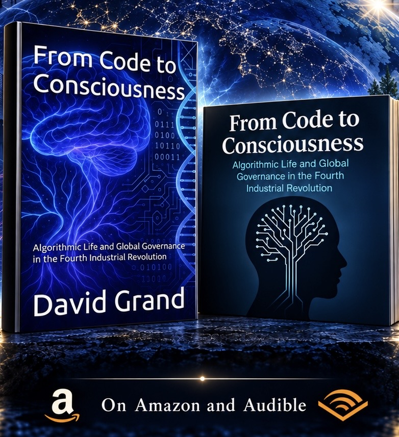

# From Code to Consciousness

## Book Overview

**From Code to Consciousness: Algorithmic Life and Global Governance in the Fourth Industrial Revolution**  
**By David Grand | Published by Grand Research Institute**

Algorithms increasingly shape what we see, how we work, how capital moves, and how institutions exercise authority. In *From Code to Consciousness*, David Grand examines the leadership challenge at the center of this transformation: who establishes the rules, who benefits from them, and who remains accountable when intelligent systems influence human lives?

Across fourteen chapters, the book connects artificial intelligence with labor, programmable biology, biometric borders, climate, finance, creativity, and personal identity. It explores how systems built to predict, rank, and optimize can become instruments of governance, affecting access to opportunity, the distribution of power, and the boundaries of individual choice.

For political leaders, executives, researchers, and engaged citizens, the central question extends beyond technological capability. It concerns institutional responsibility: how can societies preserve human judgment, dignity, and public accountability as algorithms become embedded in the infrastructure of everyday life? Grand brings these questions together through a global management perspective, connecting decisions within organizations to their consequences across economies and borders.

The book's call to action is to help shape the emerging Logic Age through conscious leadership. Understanding the systems around us is the first step. Designing institutions that embed human values into their rules is the enduring task.

**Ranked #871 in Leadership (Kindle Store), placing it within the category's Top 1,000.** Ranking recorded October 9, 2026.

**[Explore the book on Amazon](https://www.amazon.com/dp/B0FGB1BXF1)**  
First edition published July 7, 2025. English language Kindle edition: 172 pages. ASIN: B0FGB1BXF1.

## Coming Soon: The Back Door, a New Novel by David Grand

From the author of *From Code to Consciousness*.

**[Enter The Back Door: Explore the novel and game](https://back-door-october-4-original.vercel.app/)**

*From Code to Consciousness* examines how algorithms reshape work, power, and institutional responsibility. *The Back Door* carries those questions into fiction: a thriller about the engineers who build intelligent systems, the officials who authorize them, and the people who must live with their decisions.

The novel is fiction. The leadership questions it raises belong to the present: who sets the rules, who can challenge a decision, and who remains accountable when a system follows its instructions but produces an unacceptable outcome?

### From Personal Authority to Algorithmic Management

**[Watch the clip: Sinatra, Rickles, and a conversation about authority](https://www.youtube.com/shorts/mR-54MofrAk)**

Grand uses this entertainment clip as a cultural starting point for reflecting on personal authority, hierarchy, and influence. It invites a comparison with management increasingly exercised through software: allocating tasks, evaluating performance, shaping incentives, and controlling access to information.

**Algorithmic management is the central focus of David Grand's research.** This includes both the management functions performed by algorithms and the leadership required to govern those systems. AI, machine learning, agentic models, and the prospect of superintelligence sharpen the questions of delegation, oversight, and responsibility.

Building on his studies at Thunderbird School of Global Management, Grand connects global leadership and institutional governance with the management of intelligent systems embedded in organizations and physical infrastructure.

### What Comes Next?

As machines gain greater capacity to act, leaders must decide what authority to delegate, what evidence to require, and how to preserve meaningful human intervention.

*The Back Door* asks readers to imagine the consequences of those decisions.

**When the system follows every rule, who takes responsibility for the result?**

## About David Grand

David Grand lives in Florida and is the founder of Grand Research Institute. His work draws on more than two decades of experience across global business, entrepreneurship, and multiple industries, with a focus on artificial intelligence, management, and institutional governance.

He graduated magna cum laude in global management from the Thunderbird School of Global Management at Arizona State University. He is currently completing a master's in leadership and management at Thunderbird with a specialization in artificial intelligence, with completion expected in 2027.

---

## 📚 Table of Contents

Select a chapter title to open its full image.

1. [Chapter 1: The End of Reality – Technology, Choice, and the Algorithmic Frame](images/chapter1.jpeg)  
2. [Chapter 2: From Labor to Life – Platforms, Feedback Loops, and AI Governance](images/chapter2.jpeg)  
3. [Chapter 3: The DNA of Control – Genetics, Plants, and Programmable Biology](images/chapter3-complete.jpeg)  
4. [Chapter 4: Algorithmic Sovereignty – Biometric Borders and Digital Diplomacy](images/chapter4-complete.jpeg)  
5. [Chapter 5: Earth Code – Energy, Climate, and the Nervous System of the Planet](images/chapter5.jpeg)  
6. [Chapter 6: The Neuroalgorithm – Cannabis, Impairment, and Real-Time AI Health Systems](images/chapter6.jpeg)  
7. [Chapter 7: The Algorithmic Canvas – Art, AI, and the Future of Creativity](images/chapter7.jpeg)  
8. [Chapter 8: The Ledger and the Loop – Money, Trust, and the Code of Value](images/chapter8.jpeg)  
9. [Chapter 9: Mind as a Service – Cognitive Capitalism and the Commodification of Thought](images/chapter9.jpeg)  
10. [Chapter 10: Governance at the Edge – Algorithms as Law and Power](images/chapter10.jpeg)  
11. [Chapter 11: Designing Evolution – From Reactive Policy to Conscious Direction](images/chapter11.jpeg)  
12. [Chapter 12: The Self in the Feed – Identity in the Age of Algorithmic Reality](images/chapter12.jpeg)  
13. [Chapter 13: The Logic Age – A Call for Global Code Leadership](images/chapter13.jpeg)  
14. [Chapter 14: Code and Consciousness – The Human Question](images/chapter14.jpeg)  

---

## Research and Leadership Mission

Grand Research Institute connects this publication with an evolving research journey in AI, management, and governance. Its mission is to build an ecosystem of leaders who can guide technological development with institutional discipline, ethical responsibility, and a commitment to shared human prosperity.

This repository provides a visual companion to the book and a point of entry for discussion, research, and collaboration.

---

## 🚧 Status

This repository includes a visual companion to *From Code to Consciousness*, with an illustration for each of its fourteen chapters. Contributions, collaboration, and constructive critique are welcome.

- 📁 Chapter illustrations are stored in the `images/` folder  
- 🖼️ The table of contents links to chapter artwork, not the full chapter text  
- 🔐 Copyright © 2025 David Grand

---

## 🤝 Contribute

Feel free to:
- Open issues with feedback or questions  
- Submit pull requests with edits or ideas  
- Reach out if you're a policymaker, academic, or technologist interested in collaboration

---
